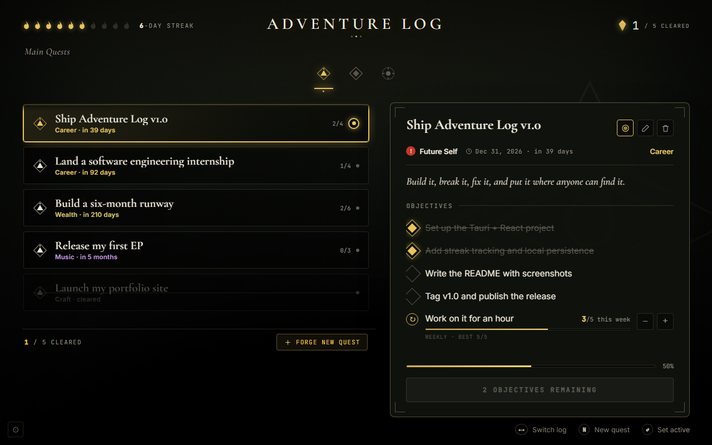
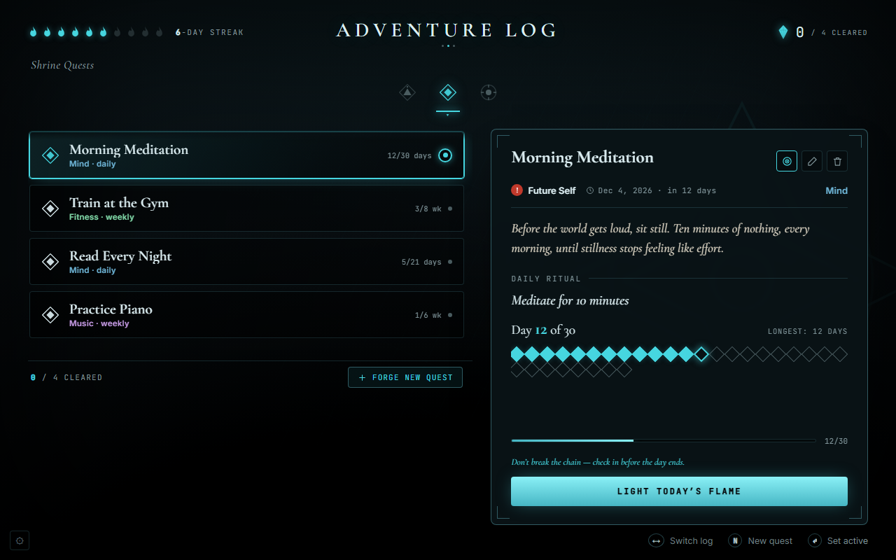
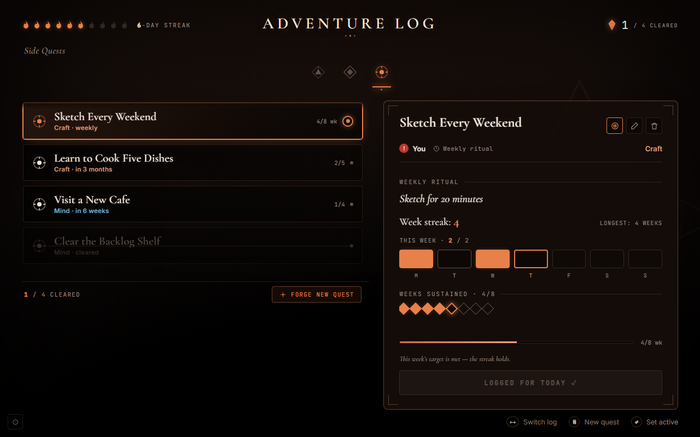
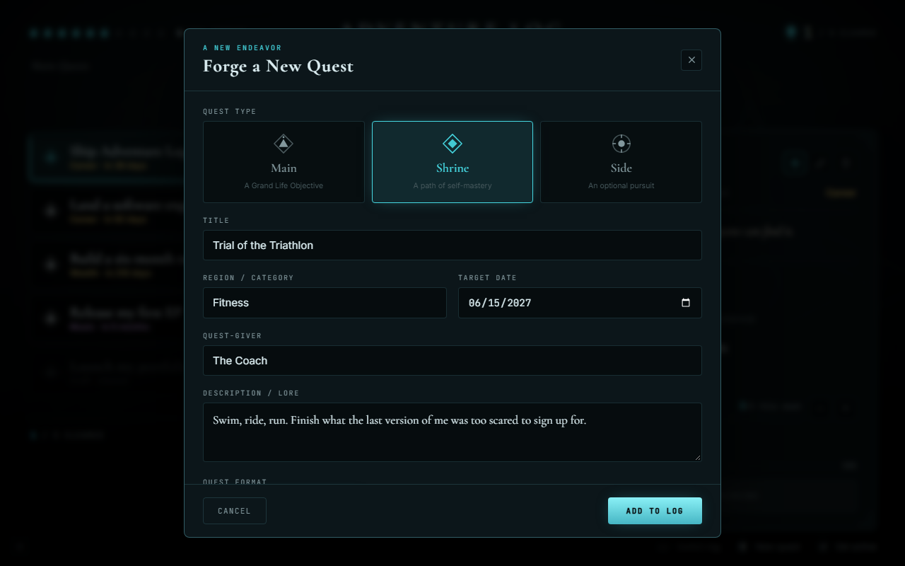
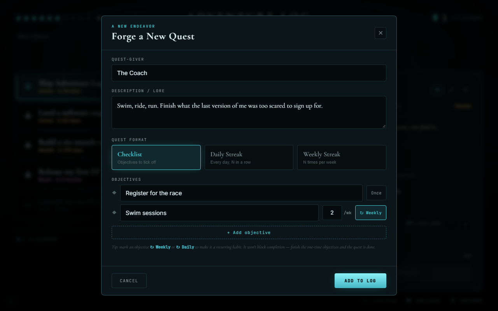

# Adventure Log

A quest log for your real life, styled like the menus in Breath of the Wild. You write your goals up as quests, check off objectives, keep daily and weekly streaks alive, and watch the whole thing glow a little brighter when you actually get stuff done.

It runs as a native desktop app on Windows and macOS. Everything saves on your own machine. No account, no server, no tracking.



## Why I made it

Todo apps are boring and I stopped opening them. I wanted something that made my goals feel like a story I was in the middle of, so I built a quest log. Big life goals are Main quests. Habits and self improvement are Shrine quests. Random stuff I want to try is Side quests.

## What it does

### Three kinds of quests

Each one has its own tab and its own color theme.

| Type | Theme | What it's for |
|------|-------|---------------|
| **Main** | Amber | The big stuff. Career, money, the goals that actually matter. |
| **Shrine** | Cyan | Self mastery. Habits and rituals you want to stick to. |
| **Side** | Ember | Optional things you want to try. No pressure. |

Switching tabs fades the whole UI into the new theme. If the color shifting gets annoying you can turn it off in settings and pick one theme.

### Three ways to track a quest

When you forge a quest you pick a format:

- **Checklist**: a list of objectives you tick off. When they are all done you can mark the quest complete.
- **Daily Streak**: do one thing every day for N days in a row. Miss a day and the chain breaks.
- **Weekly Streak**: do one thing N times per week, and keep that up for a set number of weeks.



The daily streak board is a grid of diamonds, one per day. Lit ones are done, the pulsing one is today. The button at the bottom lights today's flame. If you are about to lose the chain, the note under the progress bar tells you.



The weekly board shows Monday to Sunday for the current week, plus a row for how many weeks in a row you have hit your target.

### Forging a quest

Hit **Forge New Quest** or press `N`.



You set the type, a title, a category (Career, Wealth, Fitness, Music, Mind, Craft), a target date, a quest giver, and some lore. The lore is just a description, but writing it like the start of a story is half the fun.



Objectives can be one time tasks or recurring habits. Mark one as **Weekly** or **Daily**, set a target like 3 per week, and it shows up in the quest with a progress bar and +/- buttons. Recurring objectives never block you from finishing the quest. Do the one time ones and you are done.

### The flames up top

The row of flames in the top left is your global daily streak. Completing an objective or checking in on any quest counts as a day. Miss a full day and it resets. It maxes out at 10.

The counter in the top right is how many quests you have cleared.

### Other stuff

- **Active quest**: click the little ring on a quest to mark it as the one you are focused on. Only one can be active.
- **Celebration**: finishing a quest gets you a full screen "Quest Complete" moment.
- **Splash screen**: harp sound and a sword animation when you open the app.
- **Sound effects**: little clicks and chimes for everything. Can be turned off.
- **Settings**: the gear in the bottom left. Theme, streak meter, control hints, celebrations, and sound.
- **Saved automatically**: every change is stored locally and survives restarts.

## Keyboard shortcuts

| Key | What it does |
|-----|--------------|
| `←` `→` | Switch between Main, Shrine and Side |
| `N` | Forge a new quest |
| `Enter` | Set the selected quest as active |
| `Esc` | Close a popup |

## Download

Grab the latest installer from the [**Releases**](https://github.com/dsvin/adventure-log/releases) page.

| Platform | File |
|----------|------|
| Windows | `adventure-log_x.x.x_x64-setup.exe` |
| macOS (Intel) | `adventure-log_x.x.x_x64.dmg` |

The app is not code signed, so your OS might warn you the first time. On Windows click **More info** then **Run anyway**. On macOS right click the app and choose **Open**.

## Build it yourself

You need [Node.js 20+](https://nodejs.org) and [Rust](https://rustup.rs).

```bash
git clone https://github.com/dsvin/adventure-log.git
cd adventure-log
npm install
npm run tauri dev
```

To make an installer:

```bash
npm run tauri build
```

The installer ends up in `src-tauri/target/release/bundle/`.

### Releases

Pushing a version tag builds the Windows and macOS installers on GitHub Actions and attaches them to a release.

```bash
git tag v1.0.0
git push origin v1.0.0
```

### The icon

The app icon is generated by `make-icon.py` (needs `pillow` and `numpy`). It draws a glowing blade on a three color background. To rebuild every icon size:

```bash
python make-icon.py
npx tauri icon icon-1024.png
```

## Built with

- [Tauri 2](https://tauri.app) for the desktop shell (Rust and WebView2)
- [React 18](https://react.dev) and [TypeScript](https://typescriptlang.org)
- [Vite](https://vitejs.dev)
- Web Audio API for the sounds
- Cormorant Garamond, Inter and JetBrains Mono for fonts

## Note on the screenshots

The screenshots use made up sample quests, not real data.

## License

MIT
